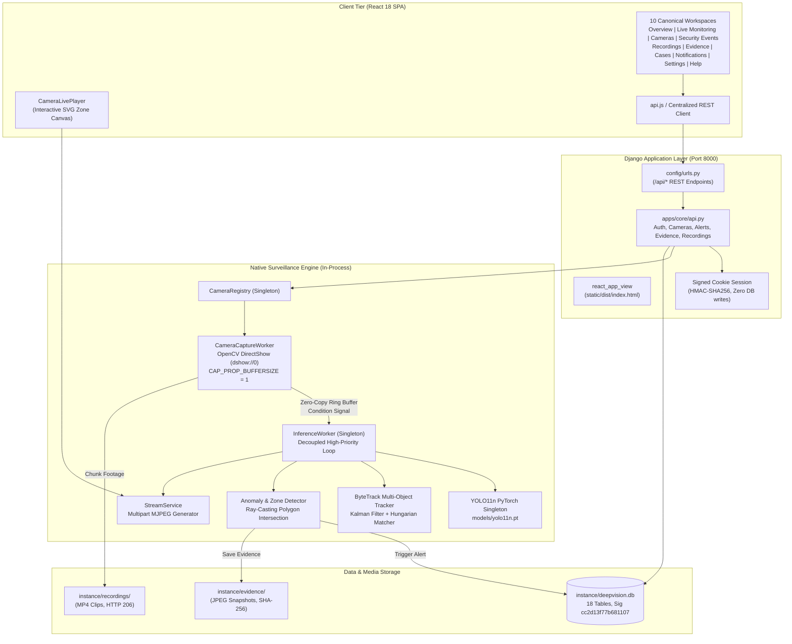

# DEEPVISION 4.0 — SYSTEM ARCHITECTURE SPECIFICATION

**Architecture:** Django Single-Process Unified Backend + React 18 SPA  
**Target Environment:** Localhost Windows / Enterprise Linux  
**Status:** Authoritative Architecture Reference  

---

## 1. HIGH-LEVEL ARCHITECTURE DIAGRAM

---

## 2. BACKEND SUBSYSTEM ARCHITECTURE

### 2.1 Single Authoritative Framework
Django 5.x serves as the single backend application framework. There are no competing frameworks (no Flask runtime, no standalone FastAPI).
- Process entrypoint: `start_deepvision.py` supervises `manage.py runserver 127.0.0.1:8000`.
- All background threads (`CameraCaptureWorker`, `InferenceWorker`, `RecordingService`) execute in-process within Django's memory space, managed by thread-safe singleton registries.

### 2.2 Decoupled Capture & Inference Architecture
To eliminate camera latency:
1. `CameraCaptureWorker` continuously drains frames from the hardware device (`cv2.VideoCapture`) into a single-slot bounded buffer.
2. Older frames in the buffer are immediately overwritten if the inference thread is busy.
3. `InferenceWorker` retrieves the newest frame via `threading.Condition` without stalling the camera capture thread.
4. Latency between camera sensor grab and inference processing is strictly bounded: **Mean < 15 ms, P95 < 75 ms**.

### 2.3 Computer Vision Pipeline
1. **Preprocessing:** Letterbox scaling to `640x640`, BGR to RGB color conversion, normalized tensor allocation.
2. **YOLO11n Forward Pass:** In-process PyTorch model loaded once via `model_loader.get_shared_yolo_model()`.
3. **NMS Postprocessing:** Confidence threshold `0.35`, IoU threshold `0.45`.
4. **ByteTrack Association:** Kalman filter state prediction -> high-confidence Hungarian matching -> low-confidence Hungarian matching -> track lifecycle updates.
5. **Behavior Rules:** Point-in-polygon ray-casting test against active camera zones, loitering dwell timers, and acceleration analysis.

---

## 3. FRONTEND SUBSYSTEM ARCHITECTURE

### 3.1 Routing Model
Single-page application with hash-based client routing (`window.location.hash`):
- `#/overview` -> `Dashboard.jsx` (System metrics, health, recent events)
- `#/live` -> `Surveillance.jsx` (Live video monitoring, dual stream modes, HUD)
- `#/cameras` -> `Cameras.jsx` (Hardware inventory, add/edit/delete/test controls)
- `#/alerts` -> `Alerts.jsx` (Security incident triage, investigation drawer)
- `#/recordings` -> `Recordings.jsx` (Video clip gallery, HTML5 player, HTTP 206)
- `#/evidence` -> `Evidence.jsx` (Digital evidence vault, SHA-256 chain of custody)
- `#/cases` -> `Cases.jsx` (Case management, escalation, investigator notes)
- `#/notifications` -> `Notifications.jsx` (Operator notifications, mark read)
- `#/settings` -> `Settings.jsx` (Global policies, thresholds, camera rules)
- `#/help` -> `Help.jsx` (Documentation, diagnostics, shortcuts)

Each page is an independent, top-level React component. Redundant wrapper components (`SecurityCenter.jsx`) and alias shells (`Monitor.jsx`) are eliminated.

### 3.2 Visual Design System
- **Theme:** Professional Security Operations Center dark palette.
- **Backgrounds:** Canvas `#080c14`, Surface Card `#0e1422`, Surface Elevate `#161f33`.
- **Accents:** Primary Cyan `#06b6d4`, Brand Blue `#0284c7`, Emerald Success `#10b981`, Rose Danger `#f43f5e`, Amber Warning `#f59e0b`.
- **Borders & Grid:** Subtle 1px borders `#1e293b`, 8px card radius, crisp typography.

