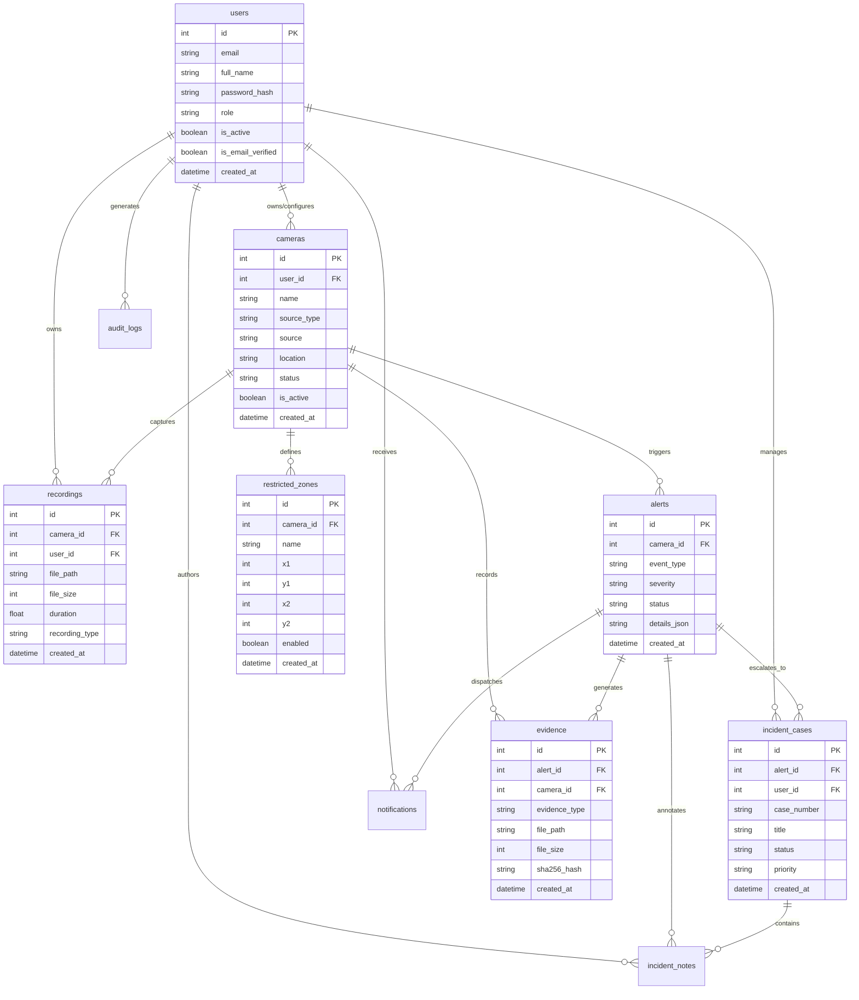

# DEEPVISION 4.0 — DATABASE DESIGN SPECIFICATION

**Database Engine:** SQLite 3 (Production Compatible: PostgreSQL)  
**Location:** `instance/deepvision.db`  
**Preflight Signature:** `cc2d13f77b681107`  
**Table Count:** 18 Canonical Tables  

---

## 1. ENTITY-RELATIONSHIP DIAGRAM

---

## 2. TABLE SPECIFICATIONS & INDEXES

### 2.1 Core Entities

1. **`users`**
   - Stores operator credentials, roles (`admin`, `supervisor`, `operator`, `user`), and email verification flags.
   - Index: `ix_users_email` (UNIQUE).

2. **`cameras`**
   - Video sources registered in the platform. Supports `webcam`, `directshow`, `rtsp`, and `phone`.
   - Foreign Key: `user_id` -> `users.id`.

3. **`restricted_zones`**
   - Bounding boxes `[x1, y1, x2, y2]` defined over camera pixel coordinates.
   - Foreign Key: `camera_id` -> `cameras.id`.

4. **`alerts`**
   - Security incidents generated by AI inference (loitering, restricted area entry, unusual motion).
   - Foreign Key: `camera_id` -> `cameras.id`.

5. **`recordings`**
   - Continuous and event-based video archives.
   - Foreign Key: `camera_id` -> `cameras.id`, `user_id` -> `users.id`.
   - Indexes: `ix_recordings_camera_id`, `ix_recordings_user_id`.

6. **`evidence`**
   - High-resolution snapshots and incident video clips.
   - Foreign Key: `alert_id` -> `alerts.id`, `camera_id` -> `cameras.id`.

7. **`incident_cases` & `incident_notes`**
   - Multi-alert incident investigation dossiers.
   - Indexes: `ix_incident_cases_case_number`, `ix_incident_cases_alert_id`.

8. **`notifications`**
   - Real-time alert notifications dispatched to active operators.
   - Foreign Key: `user_id` -> `users.id`, `alert_id` -> `alerts.id`.

9. **`audit_logs`**
   - Immutable security audit trail recording user logins, camera modifications, and status changes.
   - Indexes: `ix_audit_logs_action`, `ix_audit_logs_user_id`, `ix_audit_logs_created_at`.

---

## 3. DATA INTEGRITY RULES & CONSTRAINTS
- **Zero Accidental Drops:** Schema modifications must preserve the 18 baseline tables and schema SHA-256 hash `cc2d13f77b681107`.
- **Foreign Key Enforcement:** SQLite `PRAGMA foreign_keys = ON` enforced on connection.
- **Signed Sessions:** User sessions do NOT create database rows; session state is cryptographically signed and stored in HTTP cookies (`SESSION_ENGINE = 'django.contrib.sessions.backends.signed_cookies'`).

