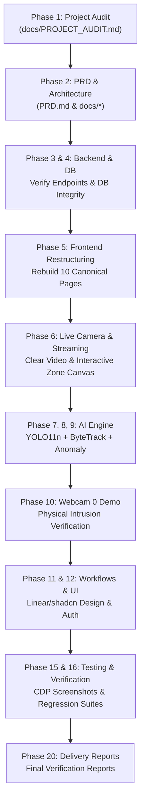

# DEEPVISION 4.0 — ARCHITECTURAL RESTRUCTURING IMPLEMENTATION PLAN

**Target:** Complete End-to-End Functional Surveillance Platform  
**Execution Order:** Autonomous Phased Loop  

---

## 1. PHASE SUMMARY & EXECUTION SEQUENCE

---

## 2. KEY REFACTORING TASKS

### Task 1: Rebuild Independent `Cameras.jsx` Page
- Extract full camera management from `Surveillance.jsx`.
- Implement camera inventory table, hardware status indicators, add/edit/delete modals, test connection button, and direct link to live monitoring.
- Ensure `Cameras.jsx` is NOT an alias, but a full-featured top-level page component.

### Task 2: Disband `SecurityCenter.jsx` and Direct-Wire Canonical Pages
- Eliminate `SecurityCenter.jsx` wrapper.
- Wire each route directly to its independent component in `App.jsx`:
  - `#/alerts` -> `Alerts.jsx`
  - `#/recordings` -> `Recordings.jsx`
  - `#/evidence` -> `Evidence.jsx`
  - `#/cases` -> `Cases.jsx`
  - `#/notifications` -> `Notifications.jsx`
- Update `Navbar.jsx` nav items to target their individual pages directly without synthetic sub-tabs.

### Task 3: Ensure Clean Route Routing in `App.jsx`
- Update `parseRoute()` to parse direct paths (`/cameras/`, `/alerts/`, etc.) and hash routes (`#/cameras`, `#/alerts`, etc.) without redirecting to tabbed wrappers.
- Provide clean unmount cleanup on all stream player components.

### Task 4: Automated Build & Verification Loop
- Run `npm run build` in `frontend/` to produce the production bundle in `deepvision_django/static/dist/`.
- Verify using Node.js CDP browser tests on all 7 viewports.
- Capture high-resolution authenticated screenshots of all 10 pages.
- Execute full regression test suites.

