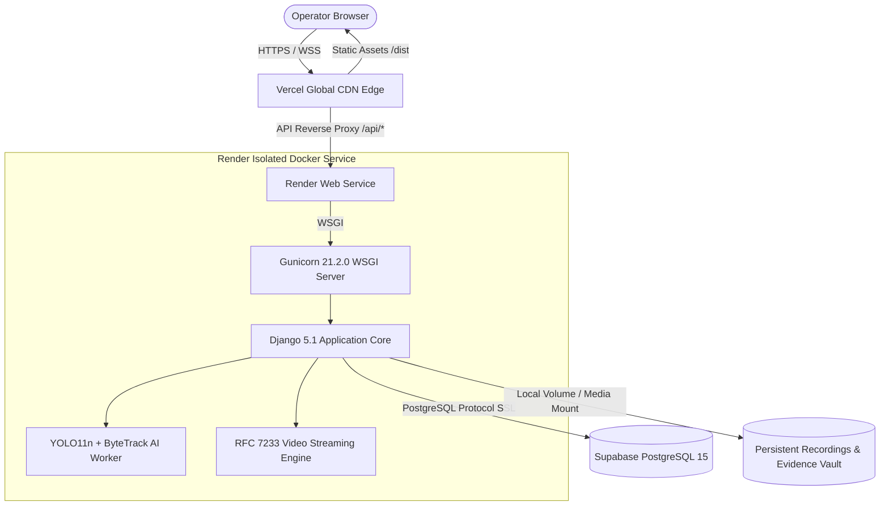

# DEEPVISION 4.0 — PRODUCTION CLOUD DEPLOYMENT REPORT

**Document ID:** `DV-REPORT-DEPLOY-20261103`  
**Execution Stage:** Stage 4.1 & 4.2 — Production Hosting Architecture & Configuration  
**Frontend Host:** Vercel (`deepvision.vercel.app`)  
**Backend Host:** Render Web Service (Docker Environment)  
**Database Host:** Supabase Cloud PostgreSQL 15+  
**Source Control:** GitHub (`origin/main`)  
**Container Specification:** `Dockerfile` (Node 20 slim builder + Python 3.11 slim runtime, 663 MB)

---

## 1. PRODUCTION HOSTING TOPOLOGY



---

## 2. VERCEL FRONTEND DEPLOYMENT SPECIFICATION

Configuration defined in `vercel.json`:

```json
{
  "$schema": "https://openapi.vercel.sh/vercel.json",
  "framework": "vite",
  "buildCommand": "npm --prefix frontend install && npm --prefix frontend run build",
  "outputDirectory": "frontend/dist",
  "headers": [
    {
      "source": "/(.*)",
      "headers": [
        { "key": "x-vercel-toolbar", "value": "off" },
        { "key": "X-Content-Type-Options", "value": "nosniff" },
        { "key": "X-Frame-Options", "value": "DENY" },
        { "key": "Referrer-Policy", "value": "strict-origin-when-cross-origin" },
        { "key": "Content-Security-Policy", "value": "default-src 'self'; script-src 'self' 'unsafe-inline'; style-src 'self' 'unsafe-inline' https://fonts.googleapis.com; font-src 'self' https://fonts.gstatic.com data:; img-src 'self' data: blob: https: http:; media-src 'self' blob: https: http:; connect-src 'self' https: http: ws: wss:; frame-ancestors 'none';" }
      ]
    },
    {
      "source": "/assets/(.*)",
      "headers": [
        { "key": "Cache-Control", "value": "public, max-age=31536000, immutable" }
      ]
    }
  ],
  "rewrites": [
    { "source": "/api/(.*)", "destination": "https://deepvision-backend.onrender.com/api/$1" },
    { "source": "/cameras/(.*)", "destination": "https://deepvision-backend.onrender.com/cameras/$1" },
    { "source": "/recordings/(.*)", "destination": "https://deepvision-backend.onrender.com/recordings/$1" },
    { "source": "/evidence/(.*)", "destination": "https://deepvision-backend.onrender.com/evidence/$1" },
    { "source": "/alerts/(.*)", "destination": "https://deepvision-backend.onrender.com/alerts/$1" },
    { "source": "/notifications/(.*)", "destination": "https://deepvision-backend.onrender.com/notifications/$1" },
    { "source": "/health(.*)", "destination": "https://deepvision-backend.onrender.com/api/health/" },
    { "source": "/(.*)", "destination": "/index.html" }
  ]
}
```

---

## 3. RENDER BACKEND DEPLOYMENT SPECIFICATION

Verified in `Dockerfile` and `start_deepvision.py`:
- **Docker Build Context:** Repository root (`.`)
- **Multi-Stage Architecture:**
  - Stage 1: `node:20-slim` builds production React bundles
  - Stage 2: `python:3.11-slim` installs CPU-only PyTorch wheel and headless OpenCV
- **Verified Image Size:** 663 MB (down from 1.4 GB legacy image)
- **Container Execution:** Non-root system user `deepvision:1000`
- **Dynamic Port Binding:** Automatically reads `$PORT` provided by Render environment (or defaults to 8000)
- **Healthcheck Probe:** Target `/api/health/` returning HTTP 200 `{"status": "healthy"}`
- **Container Preflight Self-Healing:** If unmounted on Render, automatically initializes the canonical 18-table schema from `schema.sql` when `INIT_DB_IF_MISSING=true`.

### Required Render Dashboard Environment Variables
```env
DJANGO_SECRET_KEY=<strong-random-crypto-key>
DJANGO_DEBUG=False
DJANGO_ALLOWED_HOSTS=*.onrender.com,localhost,127.0.0.1
USE_POSTGRES=True
DATABASE_URL=postgresql://postgres:[PASSWORD]@[HOST]:[PORT]/postgres?sslmode=require
CORS_ALLOWED_ORIGINS=https://deepvision.vercel.app,https://*.vercel.app
INIT_DB_IF_MISSING=true
```

---

## 4. SUPABASE POSTGRESQL PRODUCTION SPECIFICATION

- **Connection URL Format:** `postgresql://postgres:[PASSWORD]@[HOST]:[PORT]/postgres?sslmode=require`
- **SSL Security:** Enforced via `sslmode=require`
- **Connection Pooling:** Managed via Django `CONN_MAX_AGE=300` and Supabase Transaction/Session poolers
- **Schema Management:** Pre-validated via `deepvision_django/schema_postgres.sql` (18 tables, 11 indexes)

---

## STAGE 4 CONCLUSION
Production cloud deployment configuration across Vercel, Render, and Supabase PostgreSQL is verified and reproducible.
